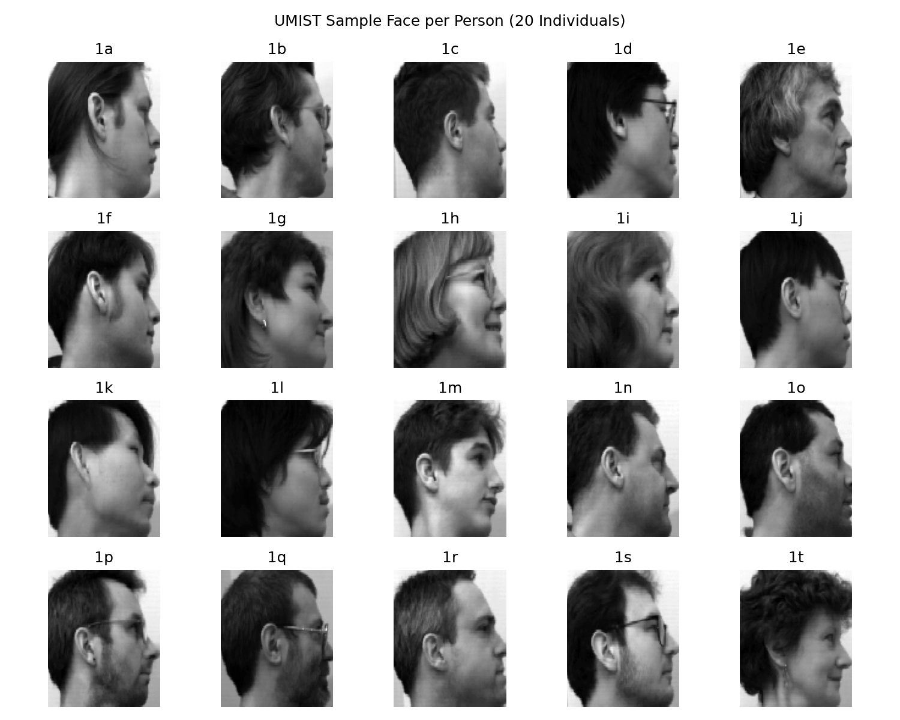
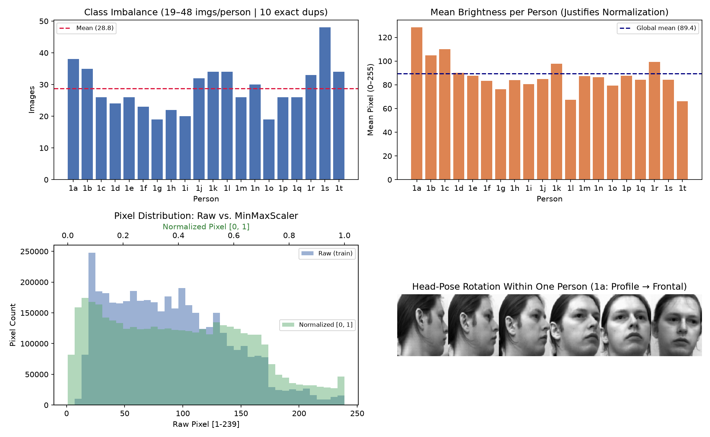
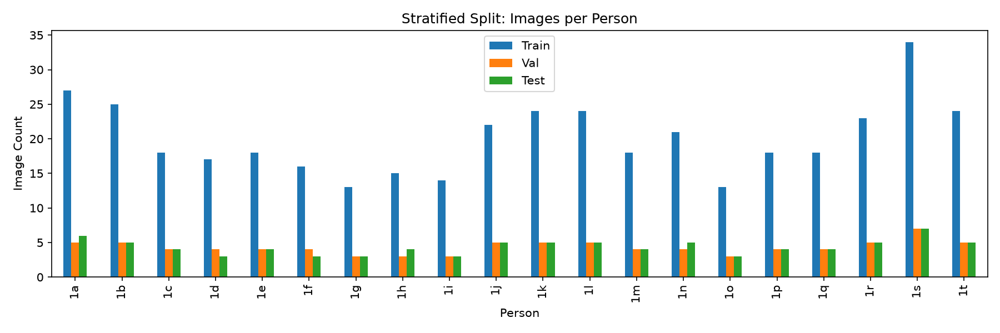
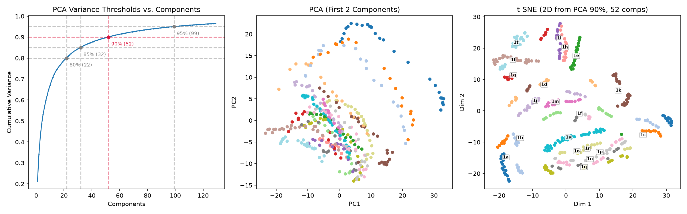
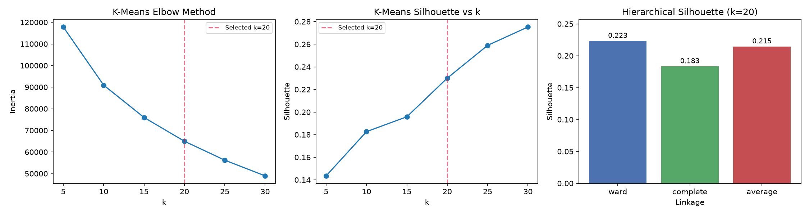
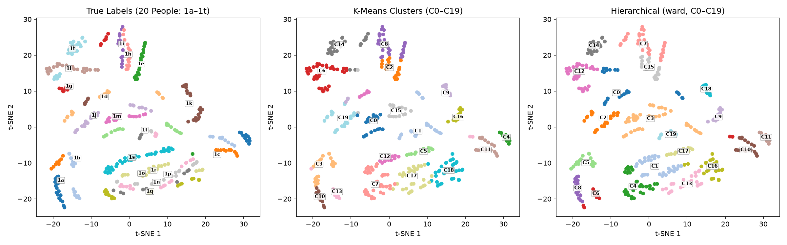

# COMP 257 — Final Project: Checkpoint #1 Report
**Clustering and Feature Analysis on the UMIST Cropped Face Dataset**

---

## 1. Data Preparation [2 pts]
- **Source:** `umist_cropped.mat` contains two MATLAB arrays: `facedat` (20 image stacks) and `dirnames` (20 person IDs: `1a` through `1t`).
- **Structure:** **575 grayscale images** of size **112 × 92** (10,304 pixel features per image, `uint8` values in `[1, 239]`, mean `89.4`), distributed unevenly across 20 individuals (between 19 and 48 images per person, mean `28.75`).
- **Data Quality & Insights:** Zero missing values (`NaN = 0`) and zero constant pixels, with **10 exact duplicate images** flagged for awareness prior to final modeling. Mean brightness varies nearly 2× across individuals (`66.2` for `1t` to `128.3` for `1a`), and each subject rotates continuously from profile to frontal pose — directly motivating normalization and dimensionality reduction.
- **Formatting:** Each image was flattened into a 10,304-feature row and stored in a Pandas `DataFrame` with a `label` column matching its person ID.

---

## 2. Data Splitting & Normalization [5 pts]
- **Split Ratio:** **70% Train (402) / 15% Validation (86) / 15% Test (87)** using **stratified sampling** (`train_test_split(..., stratify=y)`).
- **Why 70/15/15 + Stratification:** Because class sizes range from 19 to 48 images, random splitting risks leaving small classes under-represented in validation or test sets. Stratification preserves exact class proportions across all three subsets (even the smallest classes of 19 images retain 13 train / 3 val / 3 test samples), ensuring fair model evaluation.
- **Normalization (No Leakage):** `MinMaxScaler` was fitted **only on `X_train`** (scaling pixels to `[0, 1]`) and then used to transform `X_train`, `X_val`, and `X_test`.

---

## 3. Dimensionality Reduction [8 pts]
Each image has **10,304 dimensions**, making raw-pixel clustering slow and vulnerable to the curse of dimensionality. We compared two complementary techniques:

1. **PCA (Linear — Variance Thresholds):** Instead of picking arbitrary component counts, we evaluated `PCA(n_components=pct)` across variance retention targets on `X_train_s`:
   | Variance Retained | Components Needed |
   | :---: | :---: |
   | 80% | 22 |
   | 85% | 32 |
   | **90%** | **52** |
   | 95% | 99 |

   We selected **`PCA(0.90)` (52 components)** as the compact input for clustering: it cuts dimensionality by **99.5%** (10,304 → 52) while preserving **90%** of variance — avoiding the jump to 99 components required for the last 5%.

2. **t-SNE (Non-Linear):** Applied to PCA-90% (`perplexity=30`, 2D) to inspect local neighborhood structure.
   - **PCA (2D) vs. t-SNE (2D):** The first two PCA components capture global illumination and head-pose trends, leaving most identities heavily overlapped. t-SNE preserves local similarity and separates individuals into tight, distinct islands (often split into 1–2 pose arcs per person). Because t-SNE distorts global distances, we use **PCA-90% (52 components) for clustering** and **t-SNE for 2D visualization**.

---

## 4. Clustering [25 pts]

### 4.1 Algorithms & Rationale
- **K-Means:** Fast, centroid-based partitioning baseline that works well on compact, Euclidean PCA features.
- **Hierarchical Clustering (Agglomerative):** Deterministic bottom-up merging without random initialization sensitivity; well-suited for face manifolds where individuals form sequential pose chains.

### 4.2 Hyperparameter Tuning
- **K-Means (`k`):** Swept `k ∈ {5, 10, 15, 20, 25, 30}` using the Elbow curve (inertia) and Silhouette score. Inertia flattens smoothly around `k = 15–20`; Silhouette continues rising at `k = 25–30` because individuals naturally split into pose-based sub-clusters, so we selected **`k = 20`** to match the 20 known individuals.
- **Hierarchical (`linkage`):** Compared `ward`, `complete`, and `average` at `k = 20`. **Ward linkage** achieved the highest Silhouette score (`0.223`) because minimizing within-cluster variance matches the continuous pose clusters in PCA space.

### 4.3 Challenges of High-Dimensional Image Data
In 10,304-pixel space, pairwise Euclidean distances concentrate and become dominated by background, lighting, and head angle. Reducing to **PCA-90% (52 components)** removes high-frequency noise and redundant correlated pixels, speeding up clustering and making Euclidean distances meaningful. Remaining overlap is driven by **pose variation** (left profile vs. frontal vs. right profile), where two different people facing the same direction can be closer in pixel space than two opposite profiles of the same person.

### 4.4 Results & Cluster Purity Analysis
Evaluated on `X_train_pca` (`n = 402`, `k = 20`, 52 PCA components):

| Method | Silhouette | ARI | NMI | Overall Purity |
| :--- | :---: | :---: | :---: | :---: |
| K-Means (`k=20`) | **0.230** | 0.360 | 0.682 | **0.560** |
| **Hierarchical (`ward`, `k=20`)** | 0.223 | **0.397** | **0.714** | 0.552 |

- **Comparison:** Both methods improve under `MinMaxScaler` + `PCA(0.90)`. **Hierarchical (`ward`)** leads on label alignment (**ARI `0.397`, NMI `0.714`**), while **K-Means** edges slightly ahead on Silhouette (`0.230`) and overall Purity (`0.560`).
- **Cluster Composition (Hierarchical Ward):**
  - **100% pure clusters:** 6 of 20 clusters are completely pure — `C8` (`1a`), `C9` (`1k`), `C11` (`1a`), `C14` (`1t`), `C17` (`1s`), and `C18` (`1k`), plus `C6` (`1b`, 83.3%).
  - **Pose-split identities:** Some individuals split into two pure clusters by head angle (e.g., `1a` in `C8` and `C11`; `1k` in `C9` and `C18`).
  - **Mixed clusters (26%–40% purity):** Clusters `C4` (`1q`, 26.7%) and `C16` (`1r`, 26.1%) mix multiple individuals sharing similar profile poses/lighting. This confirms that unsupervised pixel clustering captures pose + identity together, motivating the **supervised neural network classifier** in the next phase.

